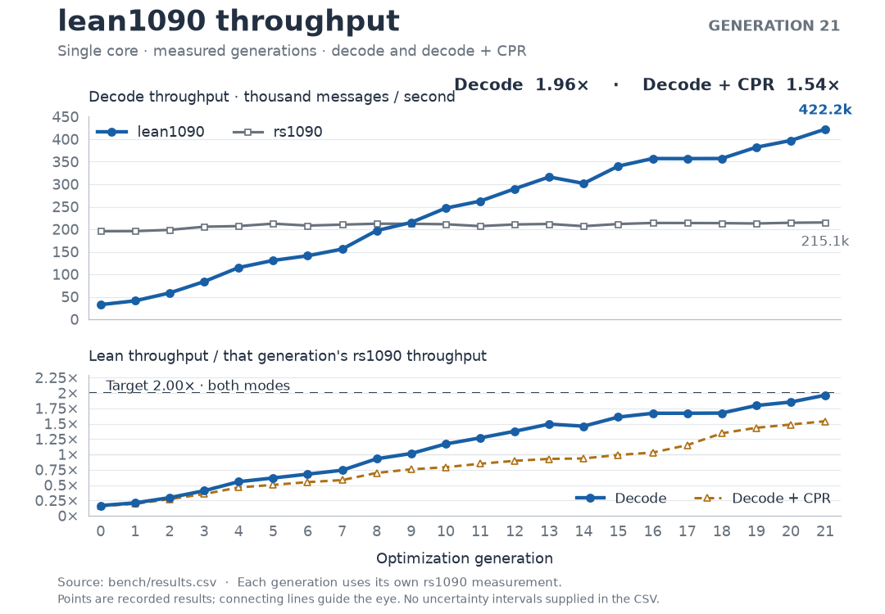

# lean1090

**Mode S and ADS-B decoding in Lean 4, with machine-checked proofs.**

A pure Lean library and JSON command-line decoder, covering the pinned
[rs1090](https://github.com/xoolive/rs1090/tree/685dfaa34c5ab186c691bca3cfe2a22e12517d30)
decoder's scope, Comm-B inference and CPR position tracking. A separate reference
specification describes the wire formats; proofs keep the optimized decoder
equal to it for **every byte input**.

On the recorded single-core workload, generation 21 reaches **1.96331× rs1090
throughput for decode and 1.53989× with CPR**. The goal is **2.00× in both modes**;
neither target is reached. All 23 capstone contracts are proved. No
project-specific trusted primitives were added.

[Get started](#try-it) · [Proofs](THEOREMS.md) · [Scope](SCOPE.md) ·
[Benchmarks](bench/GEN21.md) · [Developer guide](docs/DEVELOPING.md)

## Try it

Install [elan](https://github.com/leanprover/elan), then run from this checkout.
The Lean toolchain and Mathlib commit are pinned.

```sh
lake exe cache get
lake build lean1090
.lake/build/bin/lean1090 8D4840D6202CC371C32CE0576098
```

```json
{"bds":"08","callsign":"KLM1023","df":"17","icao24":"4840d6","wake_vortex":"n/a"}
```

Pass multiple hexadecimal messages as arguments, or one per line on standard
input. The default output preserves the standard view. `--oracle-view` selects
rs1090-compatible reporting; `--diagnostic` emits both views, CRC and the unused
input suffix. Rejected messages produce JSON `null`.

The library entrypoints are `Lean1090.Impl.decode`, `decodePrefix` and
`decodePositions`. Decoding and tracking are separate operations; the CLI above
decodes individual messages. See the [API and setup guide](docs/DEVELOPING.md).

## Performance

Generation 21, commit `11fbf4e0c8c196d70cd838dd2a14516f586fc4c5`:

| Workload | lean1090 | rs1090 | Throughput ratio |
| --- | ---: | ---: | ---: |
| Decode | **422,217 msg/s** | 215,054 msg/s | **1.96331×** |
| Decode + CPR | **329,085 msg/s** | 213,707 msg/s | **1.53989×** |

CPR overhead is **+0.670280858541 µs/message for Lean** and **+0.029311055952 µs/message for rs1090**. It is the difference between independently measured mode medians, includes measurement noise, and is not an isolated timing of CPR work.



The headline times the exact `Impl.decode` covered by the refinement theorem,
including construction of its complete result. Both implementations decode
172,432 prepared messages on CPU 0: three warmup pairs, then 21 interleaved AB
pairs; medians are reported. The measured host is an Intel Core Ultra 9 285K under
WSL2 with the Windows Ultimate Performance plan. These are results on that
workload and machine; they do not establish performance on other hosts or inputs.

[Method and environment](bench/GEN21.md) ·
[Raw decode samples](bench/runs/gen21/decode/samples.csv) ·
[Raw CPR samples](bench/runs/gen21/cpr/samples.csv) ·
[All generations](bench/results.csv) ·
[CPR overhead history](bench/CPR-OVERHEAD.md) ·
[Animated history](docs/images/throughput.gif)

## What is verified

- **Decoder refinement:** identical success, failure, fields and exact semantic
  reports for every input, including malformed inputs.
- **Wire codecs:** message, frame, ADS-B and Comm-B round-trips; CRC polynomial
  division, XOR linearity and single-bit syndromes; altitude encoding/rejection.
- **CPR:** local/global accuracy within encoding resolution under documented
  admissibility conditions,
  latitude-zone certificates and complete tracking-policy refinement.
- **Comm-B:** the full inference predicates and binary64-dependent score decisions.
  Immutable field-code tables and integer bounds accelerate the proved software
  model, with the full model retained near the score threshold.

The reference specification comes from the cited standards, with explicitly
identified rs1090-derived behavior where applicable. Proofs establish those
formal statements; they do not certify an unmodeled physical receiver or make
the specification immune to a mistaken interpretation. Numerical presentation
and CPR Float/geodesy callbacks are **tested, not proved equal to real arithmetic**.
The [theorem guide](THEOREMS.md) explains every hypothesis and its limits.

The trusted computing base is the Lean kernel, compiler and runtime, the C
compiler and the executing machine. Only `propext`, `Classical.choice` and
`Quot.sound` are permitted proof axioms. There are **zero** project-specific
`extern` or `implemented_by` primitives. See [TRUSTED.md](TRUSTED.md).

## Scope and validation

Mode S formats 0/4/5/11/16/17/18/19/20/21 and standard Comm-D 24–31; all 70 scoped
ADS-B branches; 14 direct Comm-B registers and the pinned inference policy;
airborne local/global and surface local CPR. Receiver I/O, demodulation, aircraft
databases and JSON serving are outside this library's scope.

The oracle has documented differences, including its 14-byte Comm-D rejection
and the ±87° CPR convention. Standard and compatibility views keep those choices
explicit. [Scope and units](SCOPE.md) · [Discrepancy ledger](DISCREPANCIES.md).

Before the measured commit, the full gate and a separate fresh-seed campaign each
checked 10,476,164 whole-message cases, with all 32 DF attempts, 70 ADS-B branches
and 14 register strata covered, and no unclassified differences. The gate also checks 1,011 upstream unit assertions,
152 proof witnesses, exhaustive altitude/DTE regressions, structured Comm-B
boundaries, numerical conformance and both individual and stream-level CPR.

```sh
# Prepare the pinned Rust oracle and dependency caches first:
python3 review/packaging/bootstrap.py --prepare
scripts/check_all.sh --quick   # corpus + 100k generated messages + mandatory strata
scripts/check_all.sh --full    # corpus + 10M generated messages + mandatory strata
```

The gate starts by checking the 104-file frozen specification/test inventory.
See [reproduction instructions](docs/DEVELOPING.md) and
[evidence layout](docs/EVIDENCE.md) for clean checkouts, fresh seeds and large
regenerable transcripts.

## Explore the project

| Path | Purpose |
| --- | --- |
| [Spec/](Spec/) | Readable reference semantics and independent encoders |
| [Model/](Model/) | Shared exact result types |
| [Impl/](Impl/) | Pure runtime implementation; no Spec or Mathlib imports |
| [Proofs/](Proofs/) | Refinement and characterizing theorems |
| [Tests/](Tests/) and [scripts/](scripts/) | Unit, differential and audit gates |
| [bench/](bench/) | Frozen methodology, raw measurements and generation history |
| [docs/](docs/README.md) | Sources, design decisions and review notes |

Inspired by [lean-zip](https://github.com/kim-em/lean-zip)'s verified optimization
workflow. Source provenance and third-party acknowledgments are in
[docs/SOURCES.md](docs/SOURCES.md) and [THIRD_PARTY_NOTICES.md](THIRD_PARTY_NOTICES.md).

<!-- CAPSTONES:BEGIN -->
<details>
<summary>All 23 capstone statements, verbatim</summary>

These are the frozen contract definitions from [Capstones.lean](Capstones.lean).
The [final manifest](scripts/Final.lean) binds them to their checked proofs and
actual implementation entrypoints. Definitions below use the original
`Lean1090.Capstones` namespace and `open Spec` context.

```lean
def Refinement (implementation : List UInt8 → Option Message) : Prop :=
  ∀ bytes, implementation bytes = Spec.decode bytes

def BDS50Refinement (implementation : Nat → Option Model.BDS50.Result) : Prop :=
  ∀ word, implementation word = Spec.bds50Reference word

def PrefixRefinement
    (implementation : List UInt8 → Option (Message × List UInt8)) : Prop :=
  ∀ bytes, implementation bytes = Spec.decodePrefix bytes

def MessageRoundTrips : Prop :=
  (∀ fields, Valid fields →
    Spec.decode (encodeFrame fields) = some (assigned fields)) ∧
  (∀ bytes f, Spec.decode bytes = some f → Spec.encode f = bytes)

def ADSBRoundTrips : Prop :=
  (∀ f, ValidADSB f → decodeADSB (encodeADSB f) = .ok f) ∧
  (∀ word f, decodeADSB word = .ok f → encodeADSB f = word)

def FrameRoundTrips : Prop :=
  (∀ f, decodeFrame (encodeFrame f) = some f) ∧
  (∀ bytes f, decodeFrame bytes = some f → encodeFrame f = bytes)

def ADSBFieldRoundTrips : Prop :=
  (∀ f, ValidADSBFields f → decodeADSBFields (encodeADSB f) = .ok f) ∧
  (∀ word f, decodeADSBFields word = .ok f → encodeADSB f = word)

def CRCPolynomial : Prop :=
  ∀ width word,
    Parity.polynomial 24 (Parity.syndrome width word).toNat =
      Parity.polynomialRemainder width word

def CRCLinear : Prop :=
  ∀ width a b,
    Parity.syndrome width (a ^^^ b) =
      Parity.syndrome width a ^^^ Parity.syndrome width b

def CRCSingleBit : Prop :=
  ∀ width, width = 56 ∨ width = 112 →
    (∀ i : Fin width, Parity.syndrome width (2^i.val) ≠ 0) ∧
    (∀ i j : Fin width,
      Parity.syndrome width (2^i.val) = Parity.syndrome width (2^j.val) → i = j)

def ParityOverlay : Prop :=
  ∀ width, width = 32 ∨ width = 88 → ∀ information,
    information < 2^width → ∀ address : BitVec 24,
    Parity.syndrome (width+24)
      (information*2^24 + (Parity.overlay width information address).toNat) = address

def AltitudeRoundTrips : Prop :=
  (∀ h, Altitude.Representable25 h →
    (∃ w, Altitude.encode25AC13 h = some w ∧
      Altitude.decodeAC13 w = some (.feet h)) ∧
    (∃ w, Altitude.encodeFeetAC12 .binary25 h = some w ∧
      Altitude.decodeAC12 w = some h)) ∧
  (∀ h, Altitude.RepresentableGillham h →
    (∃ w, Altitude.encodeGillham h = some w ∧ Altitude.decodeGillham w = some h) ∧
    (∃ w, Altitude.encodeFeetAC12 .gillham100 h = some w ∧
      Altitude.decodeAC12 w = some h))

def AltitudeRejection : Prop :=
  (∀ w, Altitude.validGillham w = false → Altitude.decodeGillham w = none) ∧
  (∀ h, ¬ Altitude.Representable25 h → Altitude.encode25AC13 h = none) ∧
  (∀ h, ¬ Altitude.RepresentableGillham h → Altitude.encodeGillham h = none)

def CPRLocal : Prop :=
  ∀ (mode : CPR.Medium) (odd : Bool) (p reference : CPR.Position),
    CPR.LocalAdmissible mode odd p reference →
    ∃ q, CPR.decodeLocal mode (CPR.encode mode odd p) reference = some q ∧
      CPR.WithinResolution mode odd p q

def CPRGlobal : Prop :=
  ∀ (pEven pOdd : CPR.Position) (latestOdd : Bool),
    CPR.GlobalAdmissible pEven pOdd →
    ∃ q, CPR.decodeGlobal (CPR.encode .airborne false pEven)
      (CPR.encode .airborne true pOdd) latestOdd = some q ∧
      CPR.WithinResolution .airborne latestOdd (if latestOdd then pOdd else pEven) q

def CPRZoneRejection : Prop :=
  ∀ even odd latestOdd, ¬ CPR.SameDecodedZone even odd →
    CPR.decodeGlobal even odd latestOdd = none

def CPRLatitudeZones : Prop :=
  (∀ c ∈ CPR.nlCertificates,
    CPR.CertifiesTransition c ∧ CPR.AvoidsDecodableLatitudes c) ∧
  (∀ lat, CPR.DecodableLatitude lat → CPR.nlTable lat = CPR.nlFormula (lat : ℝ))

def CommBInference : Prop :=
  ∀ df altitude word register fields,
    (register, fields) ∈ inferCommB df altitude word ↔
      commBEligible df altitude register word = true ∧
      decodeBDS register word = some fields

def CommBRoundTrips : Prop :=
  (∀ f, ValidBDS f → decodeBDS f.kind (encodeBDS f) = some f) ∧
  (∀ register word f, decodeBDS register word = some f → encodeBDS f = word)

def CommBFieldRoundTrips : Prop :=
  (∀ f, ValidBDSFields f → decodeBDSFields f.kind (encodeBDS f) = some f) ∧
  (∀ register word f, decodeBDSFields register word = some f → encodeBDS f = word)

def CommBArithmetic : Prop :=
  ∀ register, register ∈ commBCoreRegisters → ∀ word, word < 2^56 →
    CommBScoreArithmeticFinite register word

def CPRTrackingRefinement
    (implementation : CPR.Policy.Geography → CPR.Policy.UpdateReference →
      Option CPR.Position → List CPR.Policy.TimedReport →
      CPR.Policy.StreamState × List (Option CPR.Position)) : Prop :=
  ∀ geo update reference reports,
    implementation geo update reference reports =
      CPR.Policy.decodePositions geo update reference reports

def CPROutOfOrder : Prop :=
  ∀ geo update (state : CPR.Policy.AircraftState) reference timestamp
      (code : CPR.Encoded) altitude metadata,
    Binary64.sub timestamp
      (if code.odd then state.evenTimestamp else state.oddTimestamp) < 0 →
    CPR.Policy.stepAirborne geo update state reference timestamp code altitude metadata =
      ⟨state, reference, none, true⟩
```

</details>
<!-- CAPSTONES:END -->
